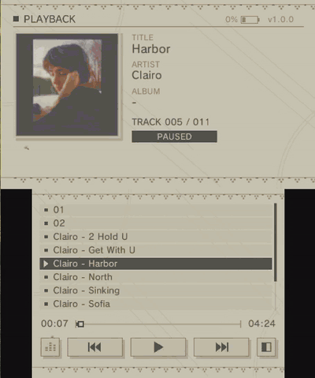

# YoRHA-3ds-MP

NieR:Automata-styled MP3 player for the Nintendo 3DS.

<p>
  
</p>

<sub>Demo recorded in the Azahar emulator; tested on real Old 3DS :3</sub>

## Features

- Works on Old 3DS
- Touch and button controls
- Spectrum and mirror visualizers
- Four color themes: YoRHA, Dark, Green and Purple
- Battery indicator
- Remembers your theme and visualizer settings

| Input | Action |
|---|---|
| Touch a song | Play it |
| Drag the list | Scroll |
| Drag the progress bar | Jump to that point in the song |
| Touch buttons | Visualizer on / off, previous / play-pause / next, switch theme |
| A | Play/pause or play the highlighted song |
| D-pad up/down | Move through the list |
| L / R | Previous / next song |
| Y / X | Back / forward 10 seconds |
| B | Turn the visualizer on / off |
| SELECT | Switch visualizer mode (spectrum / mirror) |
| START | Quit |

## Installation

- **CIA:** install `YoRHA-3ds-MP.cia` with FBI.
- **3DSX:** copy `YoRHA-3ds-MP.3dsx` to `sdmc:/3ds/` and open it from the Homebrew Launcher.

On a 3DS, run **DSP1** once first; homebrew audio needs the file it creates.

## Music

Copy your MP3s to `sdmc:/music/` (subfolders are fine). Covers come from the MP3's tags, or from a `cover.jpg` / `folder.jpg` next to the song.

## Building

Requires [devkitPro](https://devkitpro.org/wiki/Getting_Started) with the 3DS packages:

```sh
sudo pacman -S 3ds-dev 3ds-libjpeg-turbo
make        # YoRHA-3ds-MP.3dsx
make cia    # YoRHA-3ds-MP.cia
```

`make cia` also needs [makerom](https://github.com/3DSGuy/Project_CTR) and [bannertool](https://github.com/Epicpkmn11/bannertool).

## Credits

- [devkitPro](https://devkitpro.org) — libctru, citro2d, citro3d
- [dr_mp3](https://github.com/mackron/dr_libs) — MP3 decoding
- [stb_image](https://github.com/nothings/stb) — PNG decoding
- [libjpeg-turbo](https://libjpeg-turbo.org) — JPEG decoding

Fan project, not affiliated with Square Enix. Licensed under the [MIT License](LICENSE).
